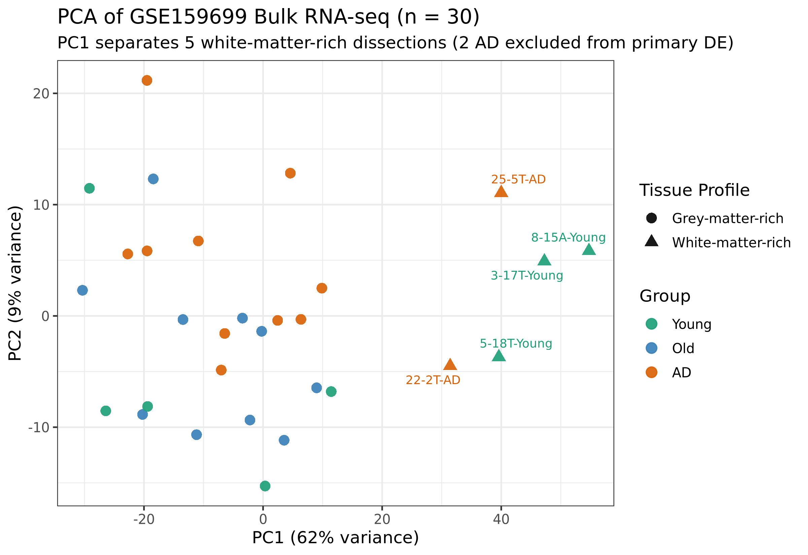
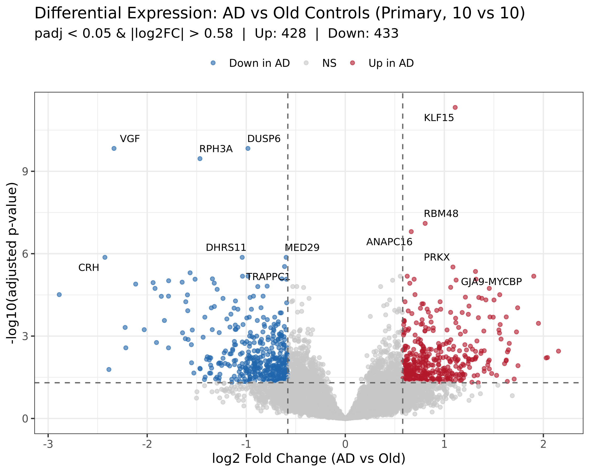
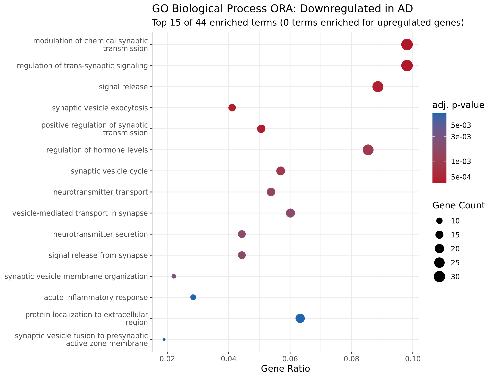
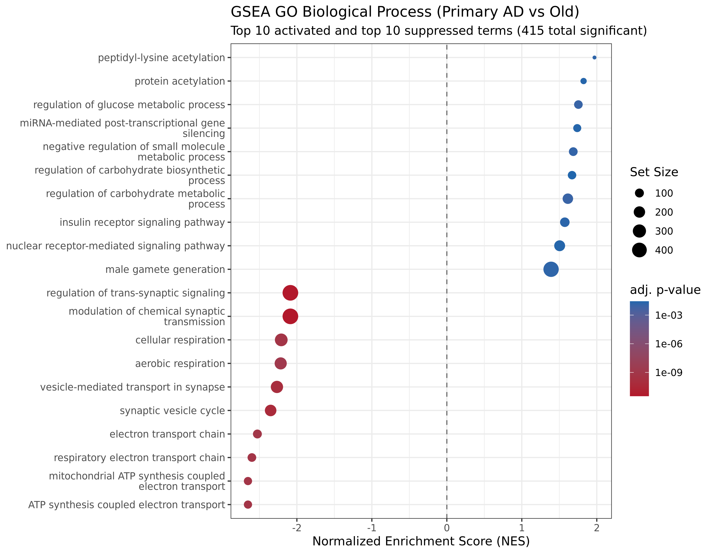
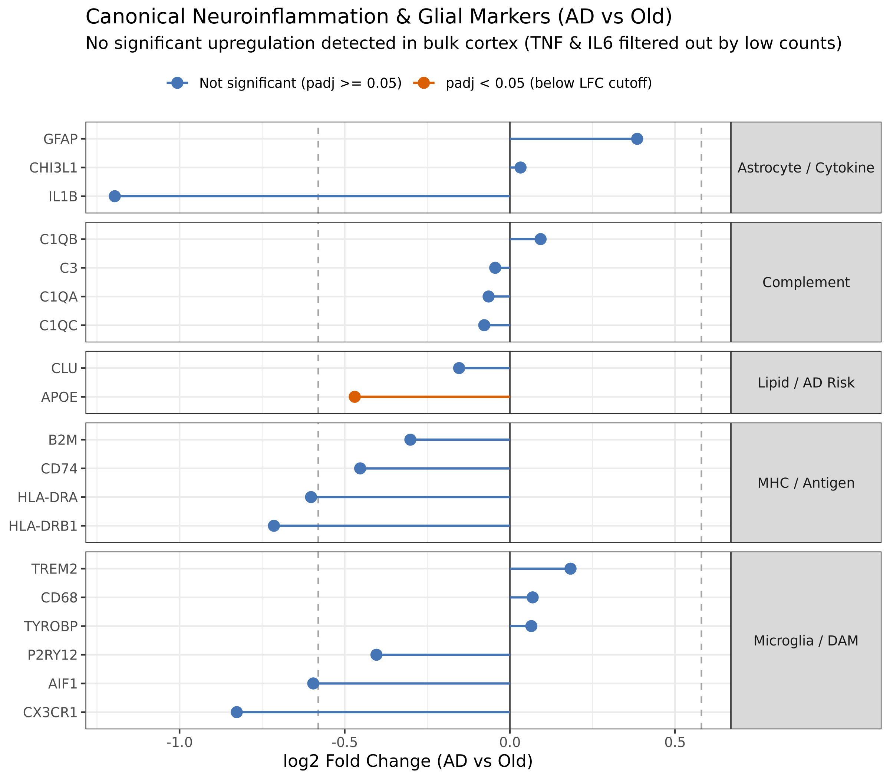

# Alzheimer's Disease Bulk RNA-seq Re-analysis (GSE159699)

Differential expression, pathway enrichment, and targeted neuroinflammation analysis of post-mortem human lateral temporal lobe bulk RNA-seq from **GSE159699** (Nativio et al., *Nature Genetics* 2020; `doi:10.1038/s41588-020-0696-0`).

## Research Question

1. What transcriptional pathways distinguish Alzheimer's disease (AD) from age-matched healthy elderly controls (Old) in human lateral temporal lobe?
2. Is canonical neuroinflammation (microglial activation, complement cascade, pro-inflammatory cytokines) detectable in this bulk RNA-seq cohort, or are pathway-level immune signals confounded by tissue composition?

## Dataset

* **Source:** NCBI GEO accession **GSE159699** (CNDR brain bank, University of Pennsylvania).
* **Samples (n = 30):** 12 AD, 10 Old controls, 8 Young controls. Primary analysis compares **AD vs Old** (age-matched).
* **Count matrix:** `GSE159699_summary_count.star.txt.gz` (~27k gene symbols × 30 samples; mitochondrial `MT-` genes absent from the provided matrix).
* **Metadata note:** The GEO series summary text states "hippocampus", whereas individual sample records indicate **lateral temporal lobe**.

## Methods

* **Exploratory QC (`02_explore.R`, `03_pc1_diagnose.R`):** Variance-stabilizing transformation (`DESeq2::vst`), PCA, sample-to-sample correlation heatmap, library depth checks, and cell-type marker profiling.
* **Differential Expression (`04_deseq2.R`):** `DESeq2` with `Old` as reference, `apeglm` log2FC shrinkage, and significance thresholds `padj < 0.05` and `|log2FC| > 0.58` (~1.5-fold).
  * **Primary model (`~ group`):** Excludes 2 white-matter-rich AD samples (`22-2T-AD`, `25-5T-AD`; PC1 > 25, a post hoc decision made after inspecting the PCA, hence the sensitivity model) → **10 AD vs 10 Old**.
  * **Sensitivity model (`~ wm_score + group`):** Retains all **12 AD vs 10 Old** samples, adjusting for a scaled white-matter score (`mean(myelin markers) - mean(neuronal markers)`).
* **Pathway Enrichment (`05_enrichment.R`, `07_sensitivity_enrichment.R`):** `clusterProfiler` GO Biological Process over-representation analysis (ORA; universe = all tested genes) and rank-based GSEA (ranked by DESeq2 Wald statistic).
* **Immune Deep-Dive (`06_immune_check.R`):** Inspection of GSEA leading-edge genes (`core_enrichment`) for all immune-related terms and targeted evaluation of 21 canonical microglial, complement, MHC, astrocyte, cytokine, and AD-risk markers.

## Key Results

### 1. Sample QC Reveals White-Matter Dissection Variability
PC1 accounts for **62% of total variance** and separates 5 samples (`22-2T-AD`, `25-5T-AD`, `8-15A-Young`, `3-17T-Young`, `5-18T-Young`) into a distinct cluster. Library depth is normal (10–19M reads), but marker profiling shows elevated oligodendrocyte/myelin genes (`PLP1`, `MOG`, `MAG`, `MOBP`) and depleted neuronal genes (`SNAP25`, `RBFOX3`, `SLC17A7`, `CAMK2A`), suggesting (my inference from marker genes) white-matter-rich dissections.



### 2. Differential Expression Is Robust Across Primary and Sensitivity Models

| Analysis | Samples (AD vs Old) | Significant Genes | Up in AD | Down in AD | Shared with Primary |
|---|---:|---:|---:|---:|---:|
| **Primary (`~ group`)** | 10 vs 10 | 861 | 428 | 433 | — |
| **Sensitivity (`~ wm_score + group`)** | 12 vs 10 | 901 | 444 | 457 | **725** |

Top primary DE genes include upregulated `KLF15`, `RBM48`, `ANAPC16`, and `PRKX`, and downregulated neuronal/neuropeptide genes `VGF`, `DUSP6`, `RPH3A`, `CRH`, and `NEUROD6`.



### 3. Synaptic and Mitochondrial Suppression Dominate Pathway Enrichment
* **ORA (Primary):** 44 GO BP terms enriched among downregulated genes (synaptic transmission, synaptic vesicle cycle, neurotransmitter transport); **0 terms** enriched among upregulated genes. Sensitivity ORA yielded 19 downregulated terms and 0 upregulated terms.
* **GSEA:** 415 significant terms in primary vs 367 in sensitivity — **329 shared terms** with **r = 0.996** NES correlation and **329/329 in the same direction**.
  * **Suppressed:** Chemical synaptic transmission, trans-synaptic signaling, and mitochondrial respiration / ATP synthesis.
  * **Activated:** Glucose/carbohydrate metabolism regulation, insulin receptor signaling, and weak protein acetylation.





### 4. No Canonical Neuroinflammation Upregulation; Suppressed Immune GSEA Terms Reflect Spillover
* Canonical DAM, complement, and astrocyte markers (`TREM2`, `TYROBP`, `CD68`, `C1QA/B/C`, `C3`, `CHI3L1`, `GFAP`) show no significant upregulation (`padj > 0.25`; `TNF` and `IL6` were filtered out due to low counts). Only `APOE` reached `padj < 0.05` (`log2FC = -0.47`, `padj = 0.044`, below the `0.58` LFC cutoff).
* Primary GSEA flagged **7 immune-related terms**, all unexpectedly *suppressed* (negative NES). Leading-edge inspection showed:
  1. Three "tumor immunity" terms were redundant subsets driven by the same ~10 genes (`CD274`, `HLA-DRB1`, `HLA-A`, `MR1`, `YWHAG`, `PRKAA1`, `USP5`).
  2. Broad terms (`immune effector process`, `humoral immune response`) contained downregulated synaptic/neuropeptide/metabolic genes (`VAMP2`, `STXBP1`, `CPLX2`, `NPY`, `VIP`, `TAC1`, `OPA1`, `GAPDH`) alongside weak, non-significant downward trends in MHC/microglial genes (`IL1B`, `HLA-DRB1`, `HLA-DRA`, `CX3CR1`, `AIF1`, `P2RY12`).
  3. After adjusting for `wm_score` in the sensitivity analysis, immune GSEA terms dropped from **7 to 2**, consistent with tissue-composition spillover (suggestive, not proof).



### 5. Comparison with Nativio et al. (2020)
The original study highlighted upregulation of histone acetyltransferases (`CREBBP`, `EP300`, `TRRAP`). All three are also significantly upregulated in both our models by adjusted p-value. This recovers the published finding from the same dataset; it is not an independent replication. Their modest effect sizes fall below our `|log2FC| > 0.58` ORA threshold (which also explains why rank-based GSEA detected protein acetylation while ORA found 0 upregulated terms):

| Gene | Primary log2FC | Primary padj | Sensitivity log2FC | Sensitivity padj |
|---|---:|---:|---:|---:|
| **CREBBP** | +0.45 | `4.8e-05` | +0.44 | `1.2e-05` |
| **EP300** | +0.25 | `1.9e-04` | +0.25 | `1.7e-04` |
| **TRRAP** | +0.30 | `5.0e-03` | +0.30 | `3.3e-03` |

## Limitations

* **Small sample size:** 10 vs 10 (primary) and 12 vs 10 (sensitivity) limits statistical power for variable inflammatory transcripts.
* **Bulk tissue & cell-composition confounding:** Neuronal loss and dissection variability (grey vs white matter) strongly influence bulk gene expression; low-abundance microglial signals can be diluted.
* **Post-mortem tissue:** Agonal state, post-mortem interval (PMI), and age-matched baseline inflammation in Old controls may mask AD-specific immune shifts.
* **Sample exclusion:** Two AD samples were excluded from the primary model based on unsupervised PCA/marker QC (mitigated via the all-sample sensitivity model).
* **Undocumented metadata:** Sample IDs contain an undocumented `A`/`T` suffix (PCA confirmed it is not a batch effect and `A`/`T` pairs are not near-duplicates). the GEO summary text says hippocampus, while the sample records indicate lateral temporal lobe.
* **Pre-filtered count matrix:** Mitochondrial (`MT-`) genes are absent from the GEO count file, preventing direct mito-fraction QC.

## How to Reproduce

```bash
conda env create -f environment.yml
conda activate geo-de
bash scripts/01_download_data.sh
for f in 02_explore 03_pc1_diagnose 04_deseq2 05_enrichment 06_immune_check 07_sensitivity_enrichment 08_final_figures; do
  Rscript scripts/$f.R
done
```

Exact R and package versions used are recorded in `results/sessionInfo.txt`. GSEA uses random permutations (`set.seed(42)`), so term counts can differ slightly between runs.

## Repository Structure

```text
.
├── environment.yml              # Conda environment specification
├── scripts/
│   ├── 01_download_data.sh       # Download GEO files with curl (R/GEOquery gets HTTP 403)
│   ├── 02_explore.R             # VST PCA & sample correlation QC
│   ├── 03_pc1_diagnose.R        # PC1 loadings & cell-type marker check
│   ├── 04_deseq2.R              # Primary & sensitivity DESeq2 models
│   ├── 05_enrichment.R          # Primary GO BP ORA & GSEA
│   ├── 06_immune_check.R        # Leading-edge & targeted immune marker check
│   ├── 07_sensitivity_enrichment.R # Sensitivity ORA/GSEA & concordance check
│   └── 08_final_figures.R       # Publication-ready figures (Fig 1–5)
└── results/
    ├── figures/final/           # Final PNG figures (300 DPI)
    └── tables/                  # DE, ORA, and GSEA CSV outputs
